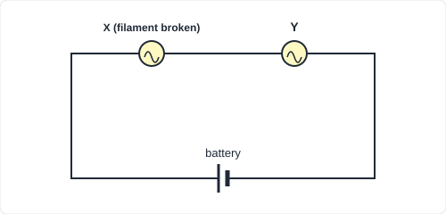
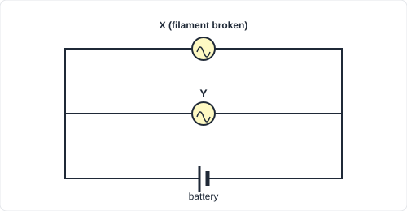
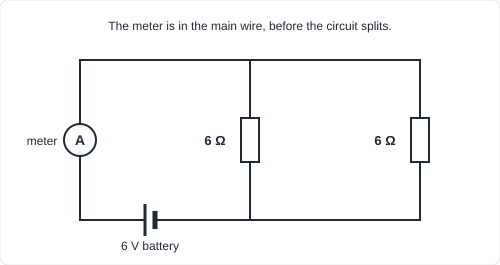

<!-- nav:top -->
[Contents](../../README.md#contents) · Previous: [Heat and temperature](heat-and-temperature.md) · Next: [Motion and forces](motion-and-forces.md)
<!-- /nav:top -->

# Electricity

**In one line:** you read simple circuits and say which bulbs light, how bright they are, how much current flows, and what makes a magnet stronger.

The circuits on this test are about as simple as circuits get: one battery, two or three bulbs or resistors, a switch, now and then a meter. Pearson names electricity as one of the content codes it uses to balance every BMCT-II form ([Pearson TalentLens](https://www.talentlens.com/bennett-mechanical.html)), so a few will turn up. If you have ever chased a dead bulb along a string of fairy lights, you have done the reasoning already. The difference on the test is doing it in 20 seconds without touching anything.

## What it measures

Whether you can follow current around a circuit and reason about what changes when a part is added, removed or broken. The core ideas:

- **Current needs a complete loop.** From one end of the battery, through the parts, and back to the other end. Any break stops the current in that loop.
- **Series means one path.** Parts in a single line share the same current. If one bulb in series breaks, everything in that line goes off. Adding bulbs in series makes each one dimmer.
- **Parallel means separate paths.** Each branch has its own loop back to the battery. A broken bulb in one branch does not affect the others.
- **Ohm's law.** Current = voltage / resistance. More voltage pushes more current. More resistance lets less through.
- **Resistance of a wire.** Longer and thinner wire has more resistance. Shorter and thicker wire has less.

## How the questions look

A circuit diagram with a battery, bulbs, resistors, switches and sometimes a meter. Or a short description of a circuit in words. Typical questions:

- Does this bulb light?
- Which bulb is brightest?
- What does the meter read?
- Which switches must be closed?
- Which electromagnet is strongest?

## A method that works

1. **Trace the loop.** Put your finger on the battery and follow the wire. Can you get back to the other end of the battery through the bulb in question, without crossing a gap?
2. **Spot series and parallel.** Parts one after another in the same line are in series. Parts on separate branches between the same two junctions are in parallel.
3. **Check every switch and break on the path.** An open switch or broken bulb on the only path stops the current. On one of several paths, it stops only that path.
4. **For numbers, add resistances in series.** Two resistors in series: total = R1 + R2. Two identical resistors in parallel: total = half of one.
5. **Then use current = voltage / resistance.**

## Traps that cost points

- **Series versus parallel.** The most common miss. A broken bulb in series puts everything out. A broken bulb in parallel leaves the other branches working.
- **Meter position.** A meter in the main wire, before the circuit splits, reads the total current. A meter in one branch reads only that branch.
- **Parallel switches.** Two switches side by side on separate branches give two routes. Either one closed completes the circuit.
- **Thicker wire, more resistance.** It is the reverse: thicker wire has less resistance, like a wider pipe.
- **Electromagnets.** More turns of wire, or more current, make a stronger magnet. The size of the battery case does not matter, the current does.

## Timing

Most circuit items take 15 to 20 seconds if you trace the loop at once. Ohm's law items need one division. If a circuit looks complex, redraw it in your head as boxes: which parts are on one line, which are on separate branches.

## Practice items

These 5 items are original, written for these notes. They are not taken from the Bennett Mechanical Comprehension Test or any publisher's materials. Batteries and bulbs are ideal unless stated, and wires have no resistance.

**Item 1.** Bulb X has a broken filament. What happens to bulb Y?

- A. Y lights normally
- B. Y lights dimly
- C. Y does not light

**Item 2.** Bulb X has a broken filament. What happens to bulb Y?

- A. Y does not light
- B. Y stays lit
- C. Y flickers on and off

**Item 3.** A 12 V battery is connected across a single 4 ohm resistor. What current flows?

- A. 48 A
- B. 8 A
- C. 3 A

**Item 4.** What does the meter read?

- A. 0.5 A
- B. 1 A
- C. 2 A

**Item 5.** A 2 ohm resistor and a 4 ohm resistor are connected in series to a 12 V battery. What current flows?

- A. 2 A
- B. 3 A
- C. 6 A

Answers and explanations, items 1 to 5

**Item 1: C (Y does not light).** X and Y are in series, on one single loop. The broken filament in X is a gap in that loop, so no current flows anywhere in it. *Why not B:* dimming happens when bulbs share a working circuit, not when the loop is broken.

**Item 2: B (Y stays lit).** X and Y are on separate branches, each with its own path back to the battery. The break in X only stops the current in X's branch. *Why not A:* that would be true in series, as in item 1.

**Item 3: C (3 A).** Current = voltage / resistance = 12 / 4 = 3 A. *Why not A:* 48 comes from multiplying instead of dividing. *Why not B:* 8 comes from subtracting.

**Item 4: C (2 A).** The meter is in the main wire, so it reads the total current. Each 6 ohm resistor has the full 6 V across it, so each carries 6 / 6 = 1 A. Together that is 2 A. Another way: two identical 6 ohm resistors in parallel have a total of 3 ohms, and 6 / 3 = 2 A. *Why not B:* 1 A is the current in one branch only. *Why not A:* 0.5 A comes from adding the resistors as if they were in series (12 ohms).

**Item 5: A (2 A).** In series, resistances add: 2 + 4 = 6 ohms. Current = 12 / 6 = 2 A. *Why not B:* 3 A uses only the 4 ohm resistor. *Why not C:* 6 A uses only the 2 ohm resistor.

Want more? The [free timed Bennett Mechanical practice test on PrepClubs](https://prepclubs.com/free-practice-tests/bennett-mechanical?utm_source=github&utm_medium=referral&utm_campaign=c6wnky&utm_content=bennett-mechanical) has the full 55 questions in 25 minutes, every answer explained.

## Score yourself

| Item | 1 | 2 | 3 | 4 | 5 |
|---|---|---|---|---|---|
| Answer | C | B | C | C | A |

- **5 of 5:** circuits are a strength. Move on.
- **3 to 4:** look for a pattern. Most misses come from series versus parallel, or from where the meter sits.
- **2 or fewer:** redraw each circuit as a loop and colour the path the current takes. Then do the items again.

## Next step

Tracing a loop is easy when nothing is ticking. Check you can still do it at test pace in the [free Bennett Mechanical practice test on PrepClubs](https://prepclubs.com/free-practice-tests/bennett-mechanical?utm_source=github&utm_medium=referral&utm_campaign=c6wnky&utm_content=bennett-mechanical).

---

<!-- nav:bottom -->
← Previous: [Heat and temperature](heat-and-temperature.md) | Next: [Motion and forces](motion-and-forces.md) → | [Back to contents](../../README.md#contents)
<!-- /nav:bottom -->
