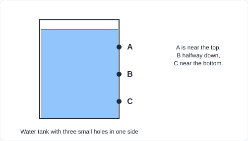
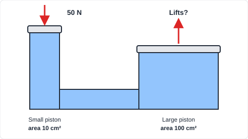
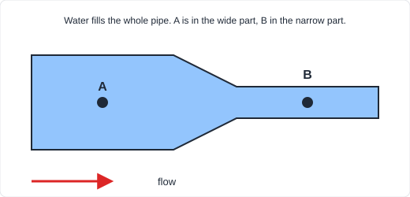
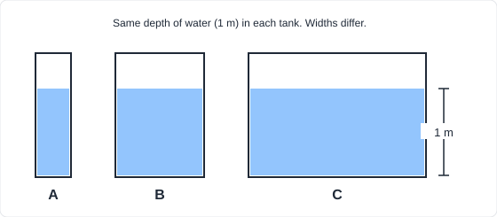
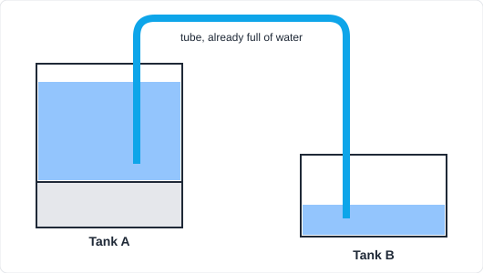

<!-- nav:top -->[Contents](../../README.md#contents) · Previous: [Pulleys, ramps, screws and wedges](pulleys-and-inclined-planes.md) · Next: [Heat and temperature](heat-and-temperature.md)<!-- /nav:top -->

# Fluids and hydraulics

**In one line:** you predict how water and other liquids behave: where pressure is highest, where flow is fastest, what floats, and how a hydraulic press multiplies force.

Think of a car jack, a garden hose with your thumb over the end, a bath draining through a bent pipe. Fluid items are those scenes drawn as diagrams. Pearson names hydraulics as one of the content codes it uses to balance BMCT-II forms ([Pearson TalentLens](https://www.talentlens.com/bennett-mechanical.html)), so plan on seeing them. Four rules about depth, levels, flow and piston areas settle nearly all of them.

## What it measures

Whether you can reason about liquids at rest and in motion without formulas. The four rules:

- **Pressure grows with depth.** The deeper you go in a liquid, the more liquid is pressing down from above. Pressure depends on depth, not on the shape or width of the container.
- **Connected open vessels fill to the same level.** Water finds one level across every open container that is joined at the bottom, whatever their shapes.
- **A narrower pipe means faster flow.** The same amount of liquid must pass every point each second, so it speeds up where the pipe narrows.
- **A hydraulic press multiplies force by the area ratio.** Pressure is the same everywhere in the trapped liquid, so a piston with ten times the area pushes with ten times the force, but moves only a tenth as far.

Floating has its own rule: an object floats when it pushes aside its own weight of liquid. Denser liquid, like salt water, holds it up with less of it under the surface.

## How the questions look

Tanks with holes, pipes that narrow, U-tubes, pistons, floating blocks, siphons and water towers. The question asks:

- Where does water come out fastest?
- Where is the pressure greatest?
- How much force does the large piston give?
- Where will the water level settle?
- Which way does the water flow?

## A method that works

1. **Decide whether the liquid is still or moving.** Still liquid: think depth and levels. Moving liquid: think flow and speed.
2. **For pressure, measure depth from the surface.** Ignore width and shape. Only vertical depth below the open surface matters.
3. **For levels, picture the liquid settling.** If containers are open and connected, the surfaces end up level.
4. **For flow, follow the pipe.** Narrow sections are fast. The liquid flows from high pressure to low pressure, which usually means from the higher surface to the lower one.
5. **For pistons, compare areas.** Big piston force = small piston force x big area / small area. Distance goes the other way.
6. **For floating, compare densities.** Denser liquid means the object floats higher.

## Traps that cost points

- **Thinking wider tanks press harder.** A wide tank holds more water, but the pressure at the bottom depends only on the depth.
- **Thinking water piles up in a narrow tube.** In connected open vessels, every surface ends at the same height.
- **Slow in the narrow part.** People picture traffic jams. In a full pipe, the liquid speeds up where the pipe narrows.
- **Forgetting the distance trade in hydraulics.** The large piston pushes harder but moves less. Force goes up by the area ratio and distance goes down by the same ratio.
- **Melting ice.** Floating ice already pushes aside its own weight of water. When it melts, it fills exactly that space, so the level does not change.

## Timing

Most fluid items need no arithmetic, only the right rule, so aim for 15 to 20 seconds. Hydraulic press items with areas need one division and one multiplication: allow about 25 seconds.

## Practice items

These 5 items are original, written for these notes. They are not taken from the Bennett Mechanical Comprehension Test or any publisher's materials.

**Item 1.** Water is leaking from three small holes in the side of the tank. From which hole does the water come out fastest?

- A. Hole A
- B. Hole B
- C. Hole C

**Item 2.** A 50 N push on the small piston holds the large piston up against a load. What is the largest load the large piston can hold? Ignore friction and the weight of the pistons.

- A. 5000 N
- B. 500 N
- C. 50 N

**Item 3.** Water flows steadily through the pipe from left to right. Where is the water moving faster?

- A. At A
- B. At B
- C. It moves at the same speed at both

**Item 4.** Each tank holds water 1 m deep. In which tank is the water pressure on the bottom greatest?

- A. Tank A
- B. Tank C
- C. It is the same in all three

**Item 5.** The bent tube is completely full of water, with one end under the surface in each tank. What happens?

- A. Water flows from A to B
- B. Water flows from B to A
- C. No water flows

Answers and explanations, items 1 to 5

**Item 1: C.** Hole C is deepest below the surface, so the pressure behind it is greatest and the water is pushed out fastest. *Why not A:* A is near the surface, with the least water pressing above it.

**Item 2: B (500 N).** The pressure is the same throughout the liquid. The large piston has 100 / 10 = 10 times the area, so it pushes with 10 times the force: 50 x 10 = 500 N. *Why not A:* 5000 N multiplies by 100, the area of the large piston, instead of by the ratio of the areas. *Why not C:* equal forces would need equal pistons.

**Item 3: B.** The same amount of water must pass every point each second. In the narrow part there is less room, so the water must move faster. *Why not A:* the wide part carries the same flow in a bigger space, so it moves more slowly.

**Item 4: C (the same).** Pressure on the bottom depends only on the depth of water above it, and all three are 1 m deep. Tank C holds more water and its bottom carries more total force, but the force on each square centimetre is the same. *Why not B:* that confuses total weight of water with pressure.

**Item 5: A (from A to B).** A full siphon tube carries water from the tank with the higher surface to the tank with the lower surface, and keeps going until the surfaces are level or the end of the tube in A comes out of the water. *Why not C:* a siphon only stops when the surfaces are level. Here A's surface is clearly higher.

Want more? The [free timed Bennett Mechanical practice test on PrepClubs](https://prepclubs.com/free-practice-tests/bennett-mechanical?utm_source=github&utm_medium=referral&utm_campaign=study-notes&utm_content=bennett-mechanical) has the full 55 questions in 25 minutes, every answer explained.

## Score yourself

| Item | 1 | 2 | 3 | 4 | 5 |
|---|---|---|---|---|---|
| Answer | C | B | B | C | A |

- **5 of 5:** fluids are solid. Move on.
- **3 to 4:** find the rule behind each miss: depth, levels, flow, area or floating. Reread that rule and redo the item.
- **2 or fewer:** write the four rules on a card. Before each item, decide which rule it is testing, then answer.

## Next step

In the real test, a fluid item can come straight after a gear or a circuit. Practise that switch in the [free Bennett Mechanical practice test on PrepClubs](https://prepclubs.com/free-practice-tests/bennett-mechanical?utm_source=github&utm_medium=referral&utm_campaign=study-notes&utm_content=bennett-mechanical).

---

<!-- nav:bottom -->← Previous: [Pulleys, ramps, screws and wedges](pulleys-and-inclined-planes.md) | Next: [Heat and temperature](heat-and-temperature.md) → | [Back to contents](../../README.md#contents)<!-- /nav:bottom -->
