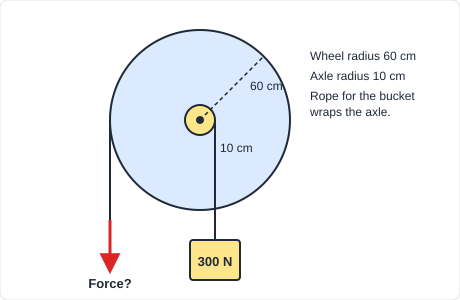

<!-- nav:top -->
[Contents](../../README.md#contents) · Previous: [Levers and balance](levers-and-balance.md) · Next: [Pulleys, ramps, screws and wedges](pulleys-and-inclined-planes.md)
<!-- /nav:top -->

# Gears, belts and wheels

**In one line:** you work out which way a gear or pulley turns, how fast it turns, and how much force a wheel and axle saves.

A gear diagram with five wheels and a belt can look like a clock with the back taken off. It is rarely as hard as it looks. Nearly every item comes down to two questions: which way does the last part turn, and how fast. Both have a rule you can apply by counting, without any feel for machinery at all.

## What it measures

These items check whether you can follow motion through a chain of parts: how direction passes from one gear to the next, and how size changes speed and force. It is the spatial side of mechanical reasoning that Pearson names as part of what the BMCT-II measures ([Pearson TalentLens](https://www.talentlens.com/bennett-mechanical.html)).

The two rules:

- **Direction.** Two gears that mesh turn in opposite directions. Pulleys joined by an open belt (not crossed) turn the same way. A crossed belt reverses direction, like meshing gears.
- **Speed.** When one wheel drives another, the smaller one turns faster. Speed times size is the same on both: teeth x rpm for gears, diameter x rpm for belt pulleys.

A third rule covers wheels and axles: a big wheel turning a small axle multiplies force, just like a long lever.

## How the questions look

A picture of gears, belts or wheels, often with one arrow showing the driving direction. Typical questions:

- Which way does gear C turn?
- How many turns does the small gear make for one turn of the big one?
- Which point on a wheel moves fastest?
- Which way does a rack move when its pinion turns?
- Which gear arrangement makes pedalling or lifting easiest?

## A method that works

1. **Find the driver.** It is the part with the arrow, or the one the question says is turned.
2. **For direction, count the meshes.** Each meshing pair flips direction. An odd number of meshes from the driver means the opposite direction. An even number means the same direction. Gears fixed to the same shaft turn together in the same direction and at the same speed.
3. **For speed, use the ratio.** Driven speed = driver speed x driver teeth / driven teeth. With belts, use diameters instead of teeth.
4. **For force, flip the ratio.** A slower output gives more turning force. A faster output gives less.
5. **For racks and belts, follow one point.** Imagine a dot on the edge of the driver where it touches the next part, and ask which way that dot moves.

## Traps that cost points

- **Losing count in long trains.** Point at each gear in turn and say "clockwise, anticlockwise, clockwise" out loud in your head.
- **Idler gears.** A gear in the middle of a train changes the direction of the next gear but not the overall speed ratio between the first and last gears.
- **Locked arrangements.** If an odd number of gears form a closed loop, each gear is told to turn both ways at once and the system cannot move. Three gears in a triangle is the classic case.
- **Same shaft, not meshing.** Two gears on one shaft do not reverse each other. People often count them as a mesh.
- **Big gear, slow speed.** The bigger gear always turns more slowly than the smaller gear it meshes with, whichever one is the driver.

## Timing

Direction items should take 10 to 15 seconds once you count meshes on reflex. Speed items with a ratio need one multiplication and one division, so allow about 25 seconds. If a gear train looks complicated, count meshes first: you can often rule out two answers straight away.

## Practice items

These 5 items are original, written for these notes. They are not taken from the Bennett Mechanical Comprehension Test or any publisher's materials.

**Item 1.** Gear A turns clockwise. Which way does gear C turn?

- A. Anticlockwise
- B. Clockwise
- C. It does not turn

**Item 2.** The big gear makes one full turn. How many turns does the small gear make?

- A. A quarter of a turn
- B. One turn
- C. Four turns

**Item 3.** The driver pulley turns clockwise. Which way does the driven pulley turn?

- A. Clockwise
- B. Anticlockwise
- C. It does not turn

**Item 4.** Gear A turns at 60 rpm. How fast does gear D turn?

- A. 30 rpm
- B. 10 rpm
- C. 90 rpm

**Item 5.** What force pulled down on the rim of the wheel will just hold the 300 N bucket? Ignore friction.

- A. 300 N
- B. 180 N
- C. 50 N

Answers and explanations, items 1 to 5

**Item 1: B (clockwise).** A clockwise, so B (one mesh away) turns anticlockwise, and C (two meshes away) turns clockwise again. Gear size does not change direction. *Why not A:* that would be right for B, not C.

**Item 2: C (four turns).** Teeth x turns is the same for both: 40 x 1 = 10 x 4. *Why not A:* a quarter turn is what the big gear makes when the small gear makes one turn. The ratio has been flipped.

**Item 3: B (anticlockwise).** A crossed belt reverses direction, just like two meshing gears. *Why not A:* clockwise would be right for an open belt, where both pulleys turn the same way.

**Item 4: B (10 rpm).** A to B: 60 x 20 / 40 = 30 rpm. C is on B's shaft, so C also turns at 30 rpm. C to D: 30 x 10 / 30 = 10 rpm. *Why not A:* 30 rpm is the speed of B and C, one stage too early. *Why not C:* 90 rpm comes from multiplying the ratios the wrong way round.

**Item 5: C (50 N).** The wheel and axle is a lever with the axle centre as the pivot. Bucket side: 300 x 10 = 3000. Rim side: F x 60 = 3000, so F = 50 N. *Why not B:* 180 N comes from subtracting distances, which has no meaning here. *Why not A:* equal force would only be right if the wheel and axle were the same size.

Want more? The [free timed Bennett Mechanical practice test on PrepClubs](https://prepclubs.com/free-practice-tests/bennett-mechanical?utm_source=github&utm_medium=referral&utm_campaign=study-notes&utm_content=bennett-mechanical) has the full 55 questions in 25 minutes, every answer explained.

## Score yourself

| Item | 1 | 2 | 3 | 4 | 5 |
|---|---|---|---|---|---|
| Answer | B | C | B | B | C |

- **5 of 5:** gears are a strength. Keep them fast and spend your time elsewhere.
- **3 to 4:** check which rule you broke: direction, ratio or same-shaft. Redo the misses with the method.
- **2 or fewer:** practise the direction rule alone first. Draw a row of circles, mark the driver, and label every gear before you think about speed.

## Next step

Counting meshes gets faster every time you do it. Get the repetitions in with a timer running, in the [free Bennett Mechanical practice test on PrepClubs](https://prepclubs.com/free-practice-tests/bennett-mechanical?utm_source=github&utm_medium=referral&utm_campaign=study-notes&utm_content=bennett-mechanical).

---

<!-- nav:bottom -->
← Previous: [Levers and balance](levers-and-balance.md) | Next: [Pulleys, ramps, screws and wedges](pulleys-and-inclined-planes.md) → | [Back to contents](../../README.md#contents)
<!-- /nav:bottom -->
