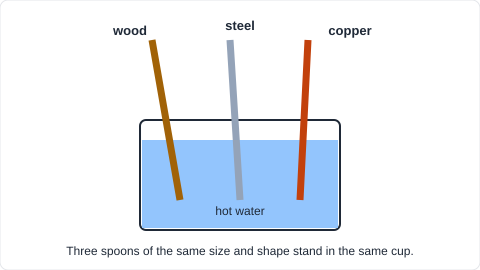
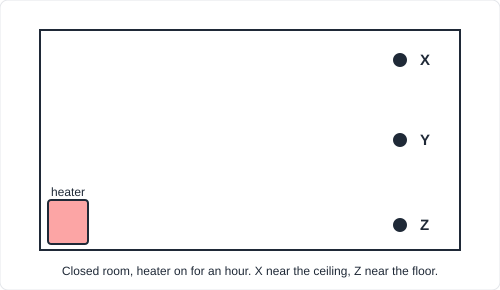
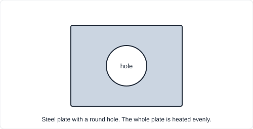

<!-- nav:top -->
[Contents](../../README.md#contents) · Previous: [Fluids and hydraulics](fluids-and-hydraulics.md) · Next: [Electricity](electricity.md)
<!-- /nav:top -->

# Heat and temperature

**In one line:** you predict what happens when things are heated or cooled: what expands, which way heat travels, and which material gets hot first.

Heat items on the BMCT-II lean on things most people have handled, such as a hot pan handle or a jar lid that only comes loose under the hot tap. Pearson names heat as one of the content codes it uses to balance BMCT-II forms ([Pearson TalentLens](https://www.talentlens.com/bennett-mechanical.html)). For most items, the work is spotting which of four processes is involved. After that, the answer usually follows.

## What it measures

Whether you understand four ideas well enough to apply them to an unfamiliar picture:

- **Expansion.** Most materials get bigger when heated and smaller when cooled. Different materials expand by different amounts. Metals generally expand more than glass.
- **Conduction.** Heat moves through solids. Metals such as copper and aluminium conduct heat well. Wood, plastic, foam and air conduct it poorly, which is why they are used as insulators and handles.
- **Convection.** Warm air and warm water rise, and cooler air and water sink. This is how a heater warms a room and why the top of a room is warmest.
- **Radiation.** Heat also travels as radiation, like sunlight. Dark, dull surfaces absorb it best. Light, shiny surfaces reflect it.

## How the questions look

A picture of a strip, rod, plate, room or container, with labels for the materials. Typical questions:

- Which way does a strip of two metals bend when heated?
- Which handle gets hot first?
- Where in the room is the air warmest?
- Does a hole in a plate get bigger or smaller when the plate is heated?
- Which container keeps a drink hot longest?

## A method that works

1. **Name the process.** Is the question about expansion, conduction, convection or radiation? Most items test only one.
2. **For expansion, ask what grows more.** The material that expands more ends up on the outside of any bend. Holes grow along with the material around them.
3. **For conduction, rank the materials.** Copper, then aluminium, then steel, then glass, then wood, plastic and foam. Air is a poor conductor too.
4. **For convection, follow warm fluid upward.** Warm air or water rises from the heat source and spreads across the top first.
5. **For radiation, look at the colour and finish.** Dark and dull absorbs and gives out more. Light and shiny reflects.

## Traps that cost points

- **Holes shrinking.** A heated plate grows in every direction, so a hole in it also gets bigger, as if the hole were made of the same metal.
- **Bending the wrong way.** In a strip of two metals, the one that expands more becomes longer and ends up on the outside of the curve.
- **"Cold travels."** Heat moves from hot to cold. A metal bench feels colder than a wooden one at the same temperature because it draws heat from your hand faster.
- **Heater placement.** A heater near the floor warms the whole room by convection, but the air near the ceiling still ends up warmest.
- **Altitude and boiling.** Water boils at a lower temperature where the air pressure is lower, high up a mountain, so food in boiling water cooks more slowly there.

## Timing

Heat items rarely need numbers. Once you name the process, the answer usually follows in 10 to 15 seconds. If you are unsure, think of a real object you have handled that works the same way.

## Practice items

These 5 items are original, written for these notes. They are not taken from the Bennett Mechanical Comprehension Test or any publisher's materials.

**Item 1.** A metal lid is stuck tight on a glass jar. Which is most likely to help loosen it?

- A. Running cold water over the lid
- B. Running hot water over the lid
- C. Putting the whole jar in the freezer

**Item 2.** Which spoon's handle end gets hot first?

- A. Wood
- B. Steel
- C. Copper

**Item 3.** Where in the room is the air warmest?

- A. At X
- B. At Y
- C. At Z

**Item 4.** A tray of dry sand and a tray of water, with the same mass and the same starting temperature, stand side by side in strong sunshine. Which warms up faster?

- A. The water
- B. The sand
- C. Both warm at the same rate

**Item 5.** The whole plate is heated evenly. What happens to the hole?

- A. It gets larger
- B. It gets smaller
- C. It stays the same size

Answers and explanations, items 1 to 5

**Item 1: B.** Metal expands more than glass when heated. Hot water makes the lid grow slightly more than the glass rim, so it loosens. *Why not A:* cold water shrinks the lid and grips the jar even tighter. *Why not C:* cooling everything shrinks the metal lid more than the glass, which also tightens it.

**Item 2: C (copper).** Copper conducts heat better than steel, and much better than wood, so heat travels up its handle fastest. *Why not B:* steel does conduct, but more slowly than copper. *Why not A:* wood is an insulator.

**Item 3: A (at X).** Air warmed by the heater rises, spreads across the ceiling and slowly sinks as it cools. The air near the ceiling ends up warmest. *Why not C:* Z is near the floor, where cooler air collects, even though the heater is at floor level.

**Item 4: B (the sand).** Water needs much more heat than sand to warm by the same amount, so with the same sunshine, the sand gets hotter faster. This is why a beach can be too hot to walk on while the sea is still cool. *Why not C:* equal mass and equal sunshine do not mean equal warming. The materials differ.

**Item 5: A (larger).** The whole plate expands evenly, as if every part of it were scaled up a little. The hole is scaled up with it. *Why not B:* it is easy to picture the metal expanding inwards, but the metal around the hole moves outwards with the rest of the plate.

Want more? The [free timed Bennett Mechanical practice test on PrepClubs](https://prepclubs.com/free-practice-tests/bennett-mechanical?utm_source=github&utm_medium=referral&utm_campaign=study-notes&utm_content=bennett-mechanical) has the full 55 questions in 25 minutes, every answer explained.

## Score yourself

| Item | 1 | 2 | 3 | 4 | 5 |
|---|---|---|---|---|---|
| Answer | B | C | A | B | A |

- **5 of 5:** move on. Heat items should be quick points for you.
- **3 to 4:** check whether you named the right process before answering. Most misses come from mixing up expansion and conduction.
- **2 or fewer:** reread the four ideas at the top and connect each one to an object at home, such as a pan, a radiator or a jar.

## Next step

Heat items are short, so they are good places to bank time for harder ones. See how quickly you clear them in the [free Bennett Mechanical practice test on PrepClubs](https://prepclubs.com/free-practice-tests/bennett-mechanical?utm_source=github&utm_medium=referral&utm_campaign=study-notes&utm_content=bennett-mechanical).

---

<!-- nav:bottom -->
← Previous: [Fluids and hydraulics](fluids-and-hydraulics.md) | Next: [Electricity](electricity.md) → | [Back to contents](../../README.md#contents)
<!-- /nav:bottom -->
