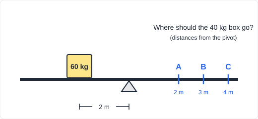
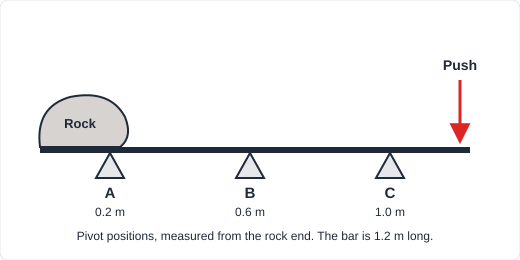
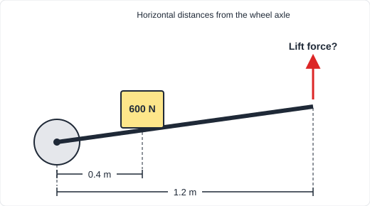
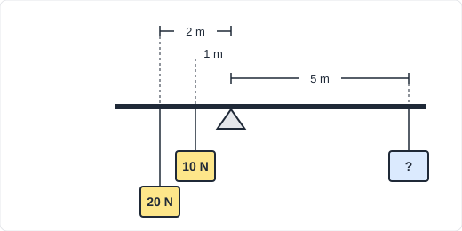
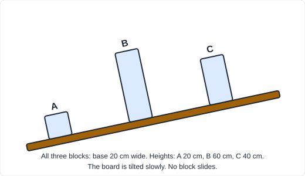

<!-- nav:top -->[Contents](../../README.md#contents) · Previous: [15-minute diagnostic](../diagnostic.md) · Next: [Gears, belts and wheels](gears-belts-and-wheels.md)<!-- /nav:top -->

# Levers and balance

**In one line:** you decide where a weight must go to balance a beam, which pivot position makes a job easier, or which object tips over first.

Seesaws, crowbars, wheelbarrows, spanners, scissors and door handles are all levers, and the test draws them in every shape you can think of. The good news is that one line of arithmetic, force times distance, handles almost all of them. If you are new to mechanical tests, start here: it is the topic where a single rule pays off fastest.

## What it measures

These items check whether you understand **turning effect**. A force turns things more strongly the further it acts from the pivot. Engineers call the turning effect a moment or torque, and you work it out like this:

> turning effect = force x distance from the pivot

A beam balances when the turning effect on one side equals the turning effect on the other.

Pearson describes the BMCT-II as measuring mechanical reasoning, spatial perception and knowledge of basic mechanics ([Pearson TalentLens](https://www.talentlens.com/bennett-mechanical.html))., and lever items draw on all three: you reason about forces, picture the layout, and apply one basic rule of mechanics.

## How the questions look

You see a picture of a beam, bar or tool with a pivot (often drawn as a small triangle), one or more weights, and sometimes distances. The question asks one of a few things:

- **Where must a weight go** to balance the beam?
- **How much force** is needed at the handle?
- **Which position** (A, B or C) makes the job easier?
- **Which support carries more** of the load?
- **Which object tips first** when its base is tilted?

The answer choices are usually short: three positions, three forces, or "A", "B" and "no difference".

## A method that works

1. **Find the pivot.** Everything is measured from it. On a wheelbarrow it is the wheel axle. On a crowbar it is the point where the bar rests.
2. **List the forces and their distances.** Write them as pairs: 60 kg at 2 m, 40 kg at ? m.
3. **Multiply each pair.** Force times distance on each side.
4. **Set the two sides equal** and solve for the unknown. With round numbers this is one line of mental arithmetic.
5. **If there are no numbers, reason from the rule.** Longer distance from the pivot means more turning effect. A load closer to a support puts more of its weight on that support.
6. **Sanity check.** A heavier weight must sit closer to the pivot to balance a lighter one. If your answer has the heavy weight further out, you swapped something.

## Traps that cost points

- **Measuring from the wrong point.** Distances must be from the pivot, not from the end of the beam.
- **Forgetting multiple weights on one side.** Add their turning effects. Two weights at different distances are not the same as their total weight at one distance.
- **Thinking a longer lever needs more effort.** It is the reverse. A longer handle, a pivot closer to the load, or pushing further from the hinge all reduce the force you need.
- **Supports versus pivots.** When a plank rests on two supports, the nearer support carries more of the load. People often guess the opposite.
- **Tipping is about height and base, not weight.** A taller object with the same base tips first because its centre of gravity is higher, whatever it weighs.

## Timing

The test gives 55 items in 25 minutes, about 27 seconds each ([Pearson TalentLens](https://www.talentlens.com/bennett-mechanical.html)). Lever items with numbers are fast once the rule is automatic: aim for 20 seconds. If the numbers do not come out cleanly, check whether you measured from the pivot, then move on.

## Practice items

These 5 items are original, written for these notes. They are not taken from the Bennett Mechanical Comprehension Test or any publisher's materials. Ignore the weight of beams, bars and planks unless the item says otherwise.

**Item 1.** A 60 kg box sits 2 m to the left of a seesaw's pivot. Where on the right should a 40 kg box go so the seesaw balances?

- A. At A (2 m)
- B. At B (3 m)
- C. At C (4 m)

**Item 2.** You want to lift the rock by pushing down on the right-hand end of the bar. Which pivot position lets you lift it with the least push?

- A. Pivot at A
- B. Pivot at B
- C. Pivot at C

**Item 3.** How much upward force at the handles lifts this wheelbarrow's load just off the ground at the front? Ignore the weight of the barrow.

- A. 200 N
- B. 300 N
- C. 600 N

**Item 4.** What weight hung at 5 m on the right will balance the beam?

- A. 6 N
- B. 10 N
- C. 30 N

**Item 5.** The board is tilted slowly. None of the blocks slide. Which block tips over first?

- A. Block A
- B. Block B
- C. Block C

Answers and explanations, items 1 to 5

**Item 1: B (3 m).** Left side: 60 x 2 = 120. Right side: 40 x 3 = 120. *Why not C:* at 4 m the 40 kg box gives 160, more than 120, so the right side would go down. *Why not A:* at 2 m it gives only 80.

**Item 2: A.** With the pivot close to the rock, the load arm is short (0.2 m) and your arm is long (1.0 m), so your push is multiplied about five times. *Why not B:* a pivot in the middle gives equal arms, so you push as hard as the rock's weight. *Why not C:* a pivot near you makes the rock's arm long and your arm short, so you need more force than the rock weighs.

**Item 3: A (200 N).** The axle is the pivot. Load: 600 x 0.4 = 240. Handles: F x 1.2 = 240, so F = 200 N. *Why not B:* 300 N would be right only if the load sat halfway, at 0.6 m. *Why not C:* that would mean lifting the whole load with no help from the wheel.

**Item 4: B (10 N).** Left side: 10 x 1 + 20 x 2 = 10 + 40 = 50. Right side: W x 5 = 50, so W = 10 N. *Why not C:* 30 N is the total weight on the left. Simply matching totals ignores the distances. *Why not A:* 6 N gives only 30 on the right.

**Item 5: B.** All three have the same base, so the tallest has the highest centre of gravity. As the board tilts, the tallest block's centre of gravity is the first to move past the edge of its base, and it tips. *Why not C:* C is shorter than B, so it needs a steeper tilt before it goes over.

Want more? The [free timed Bennett Mechanical practice test on PrepClubs](https://prepclubs.com/free-practice-tests/bennett-mechanical?utm_source=github&utm_medium=referral&utm_campaign=study-notes&utm_content=bennett-mechanical) has the full 55 questions in 25 minutes, every answer explained.

## Score yourself

| Item | 1 | 2 | 3 | 4 | 5 |
|---|---|---|---|---|---|
| Answer | B | A | A | B | B |

- **5 of 5:** you have the turning-effect rule. Move to the next section.
- **3 to 4:** check whether your misses were arithmetic or measuring from the wrong point. Redo them with the method written out.
- **2 or fewer:** go back to "A method that works" and do every item again on paper, writing each force and distance as a pair before you answer.

## Next step

Once force times distance is automatic, lever items take seconds. See whether it holds up in a mixed, timed set in the [free Bennett Mechanical practice test on PrepClubs](https://prepclubs.com/free-practice-tests/bennett-mechanical?utm_source=github&utm_medium=referral&utm_campaign=study-notes&utm_content=bennett-mechanical).

---

<!-- nav:bottom -->← Previous: [15-minute diagnostic](../diagnostic.md) | Next: [Gears, belts and wheels](gears-belts-and-wheels.md) → | [Back to contents](../../README.md#contents)<!-- /nav:bottom -->
