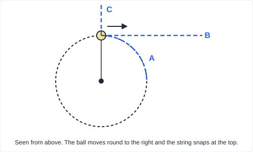
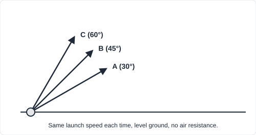
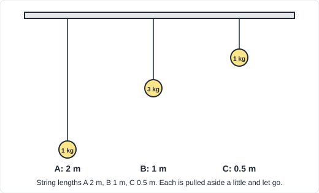
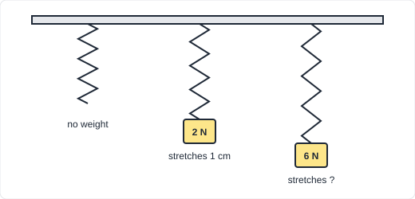

<!-- nav:top -->[Contents](../../README.md#contents) · Previous: [Electricity](electricity.md) · Next: [Sound, light, shapes and volumes](sound-light-and-shapes.md)<!-- /nav:top -->

# Motion and forces

**In one line:** you predict how things move: what falls first, which path a released object takes, what friction does, and how springs and pendulums behave.

Ask most people whether a bowling ball or a tennis ball dropped together lands first, and many will say the bowling ball. Items in this topic are often built around exactly that kind of confident wrong answer. The physics is everyday: falling, swinging, sliding, spinning. The skill is trusting a short list of rules over what feels natural.

## What it measures

Pearson says the BMCT-II measures the ability to apply physical principles and to learn mechanical concepts quickly ([Pearson TalentLens](https://www.talentlens.com/bennett-mechanical.html)). For motion items, these are the principles you will use most:

- **Things keep doing what they are doing** unless a force changes it. A moving object carries on in a straight line at the same speed. A still object stays still. This is inertia.
- **Gravity speeds everything up at the same rate.** Without air resistance, a heavy ball and a light ball dropped together land together.
- **Sideways motion and falling are separate.** A ball rolled off a table falls at the same rate as one dropped straight down from the same height.
- **Every push has an equal push back.** Throw something one way and you are pushed the other way.
- **Friction depends on the surfaces.** Rough surfaces grip more than smooth ones.
- **Springs stretch in proportion to the load.** Double the load, double the stretch, until the spring is overloaded.
- **A pendulum's swing time depends on its length,** not on the weight hanging from it.

## How the questions look

Pictures of balls, cars, boats, pendulums, springs and paths drawn as dotted lines. The questions ask:

- Which lands first?
- Which path does the object follow?
- Which way is a person or object pushed?
- Which surface needs the most force?
- Which pendulum swings fastest?

## A method that works

1. **Ask what force acts at that moment.** Gravity, a push, the string, friction, or nothing.
2. **If no force acts in a direction, motion in that direction stays the same.** A released object keeps the speed and direction it had.
3. **Split sideways motion from falling.** Work out each separately. Falling time depends only on height.
4. **For pushes, find the pair.** If A pushes B one way, B pushes A the other way.
5. **For springs, use the ratio.** Stretch is proportional to load.
6. **Distrust the answer that "feels right" if it contradicts a rule.** These items are often built around a common mistake.

## Traps that cost points

- **Heavy falls faster.** Not without air resistance. Mass does not change the rate of fall.
- **Released objects fly outward.** When a whirled object is let go, it moves off in a straight line along the direction it was moving at that instant, not directly away from the centre.
- **Thrown sideways falls slower.** A ball thrown sideways lands at the same time as one dropped from the same height.
- **Heavy pendulums swing slower.** The weight on the end makes no difference. Only the length matters: longer swings more slowly.
- **Feeling a force that is not there.** In a turning car you feel thrown outward, but really your body is carrying on straight while the car turns under you.

## Timing

Most motion items need no calculation and should take 10 to 20 seconds. Read the question twice for the word that matters, such as "first", "farthest" or "fastest". If you notice yourself choosing an answer because it feels natural, check it against the rules above.

## Practice items

These 10 items are original, written for these notes. They are not taken from the Bennett Mechanical Comprehension Test or any publisher's materials. Ignore air resistance unless the item says otherwise.

**Item 1.** Two balls of the same size, one of steel and one of plastic, are dropped at the same moment from the same height. Which lands first?

- A. The steel ball
- B. The plastic ball
- C. They land at the same time

**Item 2.** The string snaps at the moment shown. Which path does the ball take?

- A. Path A
- B. Path B
- C. Path C

**Item 3.** At the same moment, one marble is rolled quickly off the edge of a table and another is dropped straight down from the same height. Which hits the floor first?

- A. The dropped marble
- B. The rolled marble
- C. They land at the same time

**Item 4.** A car takes a sharp bend to the left at speed. Which way do the passengers feel pushed?

- A. Towards the inside of the bend, to the left
- B. Towards the outside of the bend, to the right
- C. Straight forward

**Item 5.** The same wooden box is pushed across three floors. On which does it take the most force to keep it sliding?

- A. Ice
- B. Polished wood
- C. Coarse sandpaper

**Item 6.** Which launch angle sends the ball farthest along the ground?

- A. A (30 degrees)
- B. B (45 degrees)
- C. C (60 degrees)

**Item 7.** A person standing in a small boat at rest throws a heavy bag off the back of the boat. Which way does the boat move?

- A. Forward
- B. Backward
- C. It does not move

**Item 8.** Which pendulum swings back and forth fastest, making the most swings per minute?

- A. A
- B. B
- C. C

**Item 9.** An ice skater spinning on the spot pulls her arms in close to her body. What happens to her spin?

- A. It gets faster
- B. It gets slower
- C. It stays the same

**Item 10.** A 2 N weight stretches the spring by 1 cm. How far does a 6 N weight stretch it?

- A. 2 cm
- B. 3 cm
- C. 6 cm

Answers and explanations, items 1 to 10

**Item 1: C (same time).** Without air resistance, gravity speeds up every object at the same rate, whatever its mass. *Why not A:* a heavier ball is pulled harder, but it is also harder to speed up by exactly the same amount, so the effects cancel.

**Item 2: B (path B).** Once the string snaps, nothing pulls the ball towards the centre, so it carries on in a straight line in the direction it was moving at that instant. At the top of the circle it was moving to the right. *Why not A:* following the circle needs the string's pull. *Why not C:* flying straight outward is the most common wrong answer. There is no force pushing it out.

**Item 3: C (same time).** The sideways motion does not change how fast the marble falls. Both start falling from the same height at the same moment, so both land together. The rolled marble just lands further away. *Why not A:* the dropped marble does not have a shorter path downward. Both fall the same height.

**Item 4: B (outward, to the right).** The passengers' bodies tend to keep moving straight ahead while the car turns left underneath them, so they feel pressed towards the right-hand side. *Why not A:* the car pushes them left through the seat and door, but what they feel is being pressed outward against it.

**Item 5: C (coarse sandpaper).** Rough surfaces grip more, so friction is highest on sandpaper. *Why not A:* ice is the most slippery of the three and needs the least force.

**Item 6: B (45 degrees).** With the same launch speed, level ground and no air resistance, 45 degrees gives the farthest distance. A lower angle gives less time in the air. A higher angle spends more of the speed going up. *Why not C:* 60 degrees keeps the ball in the air longer, but it moves forward more slowly.

**Item 7: A (forward).** Throwing the bag backwards pushes back on the person, and through them on the boat, in the opposite direction, so the boat moves forward. *Why not C:* nothing moving would mean the throw had no push back, which cannot happen.

**Item 8: C.** A pendulum's swing time depends on its length. The shortest pendulum swings fastest. *Why not B:* B is heavier, but the mass on the end does not change the swing time.

**Item 9: A (faster).** Pulling her arms in brings her mass closer to the centre of the spin, so she spins faster, just as a weight on a string speeds up when the string is shortened. *Why not C:* her spin is not slowed or sped by any outside push, but redistributing her mass changes how fast she turns.

**Item 10: B (3 cm).** Stretch is proportional to load. 6 N is three times 2 N, so the stretch is three times 1 cm. *Why not C:* 6 cm would mean 1 cm per newton, but the spring stretches 1 cm for every 2 N.

## Score yourself

| Item | 1 | 2 | 3 | 4 | 5 | 6 | 7 | 8 | 9 | 10 |
|---|---|---|---|---|---|---|---|---|---|---|
| Answer | C | B | C | B | C | B | A | C | A | B |

- **9 to 10:** your physical intuition is well trained. Move on.
- **6 to 8:** check whether the misses were "feels right" answers. Write down the rule each one broke.
- **5 or fewer:** reread the rules list at the top. These items reward rules over gut feeling more than any other topic.

## Next step

Trap answers are most tempting when the clock is running. Test your rules under pressure in the [free Bennett Mechanical practice test on PrepClubs](https://prepclubs.com/free-practice-tests/bennett-mechanical?utm_source=github&utm_medium=referral&utm_campaign=study-notes&utm_content=bennett-mechanical).

---

<!-- nav:bottom -->← Previous: [Electricity](electricity.md) | Next: [Sound, light, shapes and volumes](sound-light-and-shapes.md) → | [Back to contents](../../README.md#contents)<!-- /nav:bottom -->
