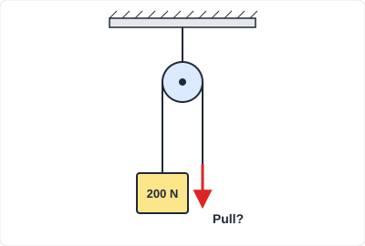
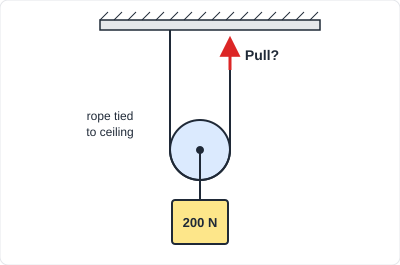
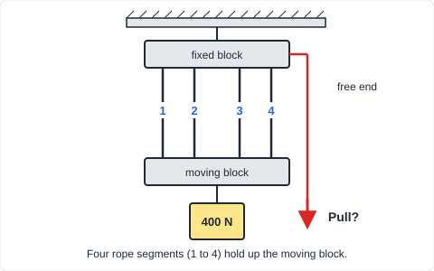
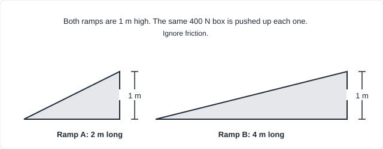
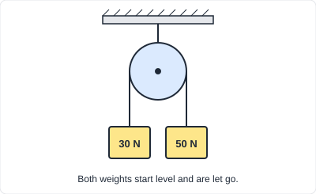
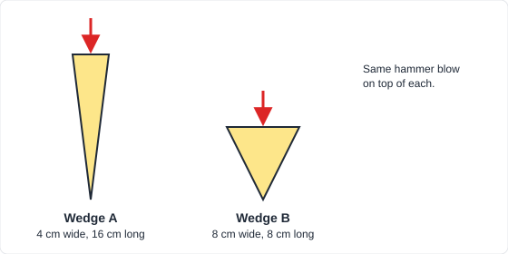

<!-- nav:top -->[Contents](../../README.md#contents) · Previous: [Gears, belts and wheels](gears-belts-and-wheels.md) · Next: [Fluids and hydraulics](fluids-and-hydraulics.md)<!-- /nav:top -->

# Pulleys, ramps, screws and wedges

**In one line:** you work out how much force a pulley system, ramp, screw or wedge needs, and what you give up in exchange.

Pulleys, ramps, screws and wedges are the oldest machines there are, and they all make the same deal with you: push or pull for longer, and you need less force. Once you see that bargain in every picture, these items become counting and dividing. Expect pulley diagrams drawn in many styles, from a single wheel to a full block and tackle.

## What it measures

These items test whether you understand mechanical advantage: how a machine lets a small force move a large load. They draw on the "knowledge in basic mechanics" that Pearson lists among the abilities the BMCT-II measures ([Pearson TalentLens](https://www.talentlens.com/bennett-mechanical.html)).

Three rules carry almost every item:

- **Pulleys: count the supporting ropes.** Ignoring friction and the weight of the pulleys, the pulling force equals the load divided by the number of rope segments holding up the moving pulley or block.
- **A fixed pulley only changes direction.** One pulley fixed to the ceiling lets you pull down instead of up, but you still pull with the full weight of the load.
- **Ramps, screws and wedges: longer path, less force.** For a frictionless ramp, force along the ramp = load x height / length.

Behind all three is one idea: the work you put in equals the work you get out (when friction is ignored). Work is force times distance. Halve the force and you must move twice as far.

## How the questions look

A picture of a pulley system, ramp, wedge or screw with a load. The question asks:

- How much force is needed to hold or lift the load?
- Which of two or three systems needs the least force?
- How far does the load move when you pull the rope a given distance?
- Which way does an unbalanced pulley system move?

## A method that works

1. **Find what moves with the load.** For pulleys, that is the moving pulley or the lower block. For a ramp, it is the box.
2. **Count the rope segments holding it up.** Count only the straight runs of rope that go up from the moving pulley or block. Do not count the free end you pull, unless it also pulls up on the moving block.
3. **Divide.** Force = load / number of supporting segments.
4. **For distance, multiply.** The rope you pull moves that many times further than the load rises.
5. **For ramps, use the ratio.** Force = load x height / length. A ramp twice as long needs half the force.
6. **Check the trade.** If your answer needs less force, the distance must be longer. If both force and distance shrank, something is wrong.

## Traps that cost points

- **Counting the free end.** In a system with one moving pulley, the free end pulling upward does count, because it pulls on the moving pulley. A free end that comes down from a fixed pulley does not. Look where each rope segment pulls.
- **Thinking a fixed pulley halves the force.** It does not. It only changes direction.
- **Thinking a ramp saves work.** It saves force, not work. Without friction, the work to raise a load is the same however you raise it.
- **Ignoring the height.** Two ramps of the same length but different heights need different forces. Use height divided by length, not length alone.
- **Wedges and screws.** A thin, long wedge and a fine screw thread both give more force for each push or turn, at the cost of more distance.

## Timing

Pulley items reduce to counting and one division, so 15 to 20 seconds is realistic. Ramp items with numbers need one multiplication and one division. Count ropes with your finger on the screen if it helps, segment by segment, so you do not double-count.

## Practice items

These 10 items are original, written for these notes. They are not taken from the Bennett Mechanical Comprehension Test or any publisher's materials. Ignore friction and the weight of pulleys and ropes in every item.

**Item 1.** What force is needed on the rope to hold the 200 N load still?

- A. 100 N
- B. 200 N
- C. 400 N

**Item 2.** What upward pull holds the 200 N load still?

- A. 200 N
- B. 400 N
- C. 100 N

**Item 3.** What pull on the free end holds the 400 N load still?

- A. 100 N
- B. 200 N
- C. 400 N

**Item 4.** In a system like the one in item 2, a single movable pulley with one end of the rope tied to the ceiling, you pull the free end up by 1 m. How far does the load rise?

- A. 2 m
- B. 1 m
- C. 0.5 m

**Item 5.** The same 400 N box is pushed up each ramp. Which ramp needs the smaller push?

- A. Ramp A
- B. Ramp B
- C. Both need the same push

**Item 6.** A ramp is 5 m long and rises 1 m. What force along the ramp pushes a 500 N box up it at a steady speed?

- A. 500 N
- B. 100 N
- C. 250 N

**Item 7.** A 400 N box can be lifted straight up by 1 m, or pushed up a frictionless ramp to the same height. Which way takes more work?

- A. Pushing it up the ramp
- B. Lifting it straight up
- C. Both take the same work

**Item 8.** The weights are let go. What happens?

- A. The 50 N weight moves down
- B. The 30 N weight moves down
- C. Nothing moves

**Item 9.** A screw moves 2 mm into the wood with each full turn. How many full turns drive it 1 cm into the wood?

- A. 20
- B. 10
- C. 5

**Item 10.** Each wedge is hit with the same hammer blow. Ignoring friction, which wedge pushes the two halves of a log apart with more force?

- A. Wedge A
- B. Wedge B
- C. Both push with the same force

Answers and explanations, items 1 to 10

**Item 1: B (200 N).** A single fixed pulley does not move with the load, so it gives no force advantage. It only lets you pull down instead of up. *Why not A:* halving the force needs a moving pulley.

**Item 2: C (100 N).** The pulley moves with the load and is held up by two rope segments: the one tied to the ceiling and the one you pull. Each carries half: 200 / 2 = 100 N. *Why not A:* that is the answer for a fixed pulley.

**Item 3: A (100 N).** Four rope segments hold up the moving block, so each carries 400 / 4 = 100 N. The free end comes down from the fixed block and is part of the same rope, so your pull is also 100 N. *Why not B:* 200 N comes from counting only two segments, as if there were one moving pulley.

**Item 4: C (0.5 m).** With two supporting segments, both must shorten for the load to rise. Pulling 1 m of rope shares that 1 m between the two segments, so each shortens by 0.5 m and the load rises 0.5 m. Half the force, twice the distance. *Why not A:* that has the trade backwards.

**Item 5: B (ramp B).** Both ramps raise the box 1 m. Force = 400 x 1 / length: ramp A needs 400 x 1 / 2 = 200 N, ramp B needs 400 x 1 / 4 = 100 N. *Why not C:* the work is the same, but the force is not. Ramp B spreads the work over a longer distance.

**Item 6: B (100 N).** Force = 500 x 1 / 5 = 100 N. *Why not C:* 250 N would be right for a ramp 2 m long. *Why not A:* that is the force for lifting straight up.

**Item 7: C (same work).** Work = force x distance. Straight up: 400 N x 1 m. Up the ramp: a smaller force over a longer distance, which comes to the same amount with no friction. *Why not B:* lifting straight up needs more force, not more work.

**Item 8: A (the 50 N weight moves down).** A fixed pulley transmits the same tension to both sides. The heavier side wins and moves down, pulling the lighter one up. *Why not C:* the weights would only stay still if they were equal.

**Item 9: C (5 turns).** 1 cm is 10 mm, and 10 / 2 = 5 turns. *Why not B:* 10 turns would be right for a finer thread of 1 mm per turn.

**Item 10: A (wedge A).** A wedge works like a ramp turned on its side. The longer and thinner it is, the more it multiplies the force of the blow: wedge A is four times as long as it is wide, wedge B only as long as it is wide. *Why not B:* a thick, short wedge opens the gap faster per blow but needs much more force to drive in.

## Score yourself

| Item | 1 | 2 | 3 | 4 | 5 | 6 | 7 | 8 | 9 | 10 |
|---|---|---|---|---|---|---|---|---|---|---|
| Answer | B | C | A | C | B | B | C | A | C | A |

- **9 to 10:** you have the trade between force and distance. Move on.
- **6 to 8:** most misses here come from counting rope segments. Redo items 1 to 4 and say out loud which segments pull up on the moving part.
- **5 or fewer:** reread the three rules at the top, then sketch each system and mark every rope segment that holds up the load.

## Next step

Real pulley drawings vary a lot. Get used to counting ropes in unfamiliar layouts in the [free Bennett Mechanical practice test on PrepClubs](https://prepclubs.com/free-practice-tests/bennett-mechanical?utm_source=github&utm_medium=referral&utm_campaign=study-notes&utm_content=bennett-mechanical).

---

<!-- nav:bottom -->← Previous: [Gears, belts and wheels](gears-belts-and-wheels.md) | Next: [Fluids and hydraulics](fluids-and-hydraulics.md) → | [Back to contents](../../README.md#contents)<!-- /nav:bottom -->
