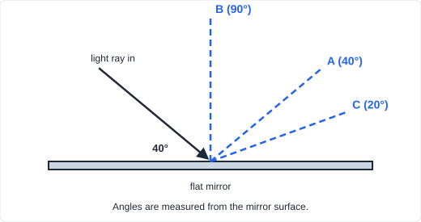
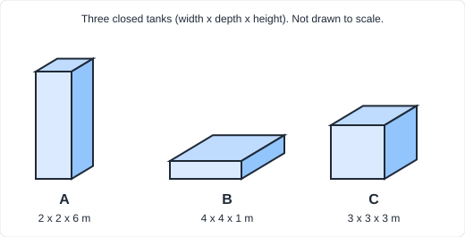
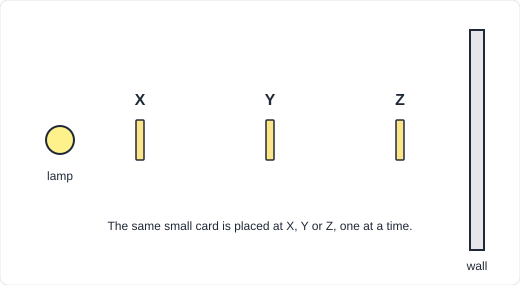

<!-- nav:top -->
[Contents](../../README.md#contents) · Previous: [Motion and forces](motion-and-forces.md) · Next: [How scoring works](../scoring.md)
<!-- /nav:top -->

# Sound, light, shapes and volumes

**In one line:** you reason about how sound and light travel, how mirrors and shadows behave, and which container holds the most.

Most Bennett prep material skips these topics, which is a reason to give them an hour. Pearson's 2025 product sheet says the BMCT-II can assess 12 mechanical domains, and it names acoustics next to forces and hydraulics ([Pearson TalentLens, BMCT-II sheet, 2025, in French](https://www.talentlens.com/content/dam/school/global/Global-Talentlens/fr/documents-solutions/Pearson-TalentLens-BMCT-2025.pdf)). Spatial perception, which covers judging shapes and volumes, is one of the four abilities on Pearson's [product page](https://www.talentlens.com/bennett-mechanical.html). Each item here needs one short rule and sometimes one multiplication.

## What it measures

Whether you can apply everyday rules about waves and space:

- **Light is far faster than sound.** You see a distant event before you hear it.
- **Sound needs something to travel through,** and it moves faster through solids and liquids than through air.
- **Pitch depends on how fast something vibrates.** Shorter, tighter or thinner strings vibrate faster and sound higher.
- **A moving sound source changes pitch.** Coming towards you, the pitch is higher. Going away, it is lower.
- **Mirrors reflect at equal angles.** The angle a ray makes with the mirror on the way in equals the angle on the way out.
- **Light bends when it passes between water and air,** which is why a straw in a glass looks broken at the surface.
- **Shadows grow as an object moves towards the light.**
- **Volume is length x width x height** for a box. For a cylinder, the area of the circular base times the height, and the base area grows with the square of the diameter.

## How the questions look

A picture of a mirror and a light ray, a lamp and a shadow, containers of different shapes, or a short everyday scene such as a thunderstorm or a passing siren. The questions ask:

- Which path does the reflected light take?
- Where should the object go to make the biggest shadow?
- Which container holds the most?
- Why does something look or sound the way it does?

## A method that works

1. **Decide whether it is sound, light or space.** Each has its own short set of rules above.
2. **For mirrors, match the angles.** Measure the incoming angle from the mirror and pick the outgoing path with the same angle on the other side.
3. **For shadows, picture lines from the light past the edges of the object.** The closer the object is to the light, the more those lines spread before they reach the wall.
4. **For volumes, work out each one.** Do not judge by height or by how big a shape looks. Multiply.
5. **For cylinders, remember the square.** Doubling the diameter makes the base four times as big.

## Traps that cost points

- **Judging volume by eye.** A tall, thin container often looks bigger than a short, wide one that holds more.
- **Doubling the diameter doubles the volume.** It quadruples it. Width counts twice for a circle.
- **Echo timing.** Sound goes to the wall and back, so the echo's delay covers twice the distance.
- **Thunder and lightning happen together.** You hear the thunder later only because sound is slower.
- **Mirror angles.** Pick the path with the same angle to the mirror, on the opposite side of the point where the ray hits. Straight back up is only right if the ray comes in straight down.

## Timing

Most of these items are one-rule questions. Allow 15 seconds, or about 25 for a volume item with arithmetic. If two volumes look close, calculate both rather than guessing.

## Practice items

These 5 items are original, written for these notes. They are not taken from the Bennett Mechanical Comprehension Test or any publisher's materials.

**Item 1.** A ray of light hits the mirror at the angle shown. Which path does the reflected ray take?

- A. Path A
- B. Path B
- C. Path C

**Item 2.** You shout towards a cliff 170 m away. Sound travels at about 340 m per second in air. How long until you hear the echo?

- A. About 1 second
- B. About half a second
- C. About 2 seconds

**Item 3.** Which tank holds the most water?

- A. Tank A
- B. Tank B
- C. Tank C

**Item 4.** An ambulance with its siren on drives past you at a steady speed. What happens to the pitch you hear at the moment it goes past you?

- A. It rises
- B. It falls
- C. It stays the same

**Item 5.** Where should the card be placed to cast the largest shadow on the wall?

- A. At X
- B. At Y
- C. At Z

Answers and explanations, items 1 to 5

**Item 1: A (40 degrees).** A mirror reflects light at the same angle it arrives. The ray comes in at 40 degrees to the mirror, so it leaves at 40 degrees on the other side. *Why not B:* straight up would only happen if the ray came in straight down, at 90 degrees.

**Item 2: A (about 1 second).** The sound travels to the cliff and back: 170 x 2 = 340 m. At 340 m per second, that takes 1 second. *Why not B:* half a second is the time to reach the cliff, without the return trip.

**Item 3: C (tank C).** A: 2 x 2 x 6 = 24 cubic metres. B: 4 x 4 x 1 = 16 cubic metres. C: 3 x 3 x 3 = 27 cubic metres. *Why not A:* A is the tallest, but tallest is not biggest.

**Item 4: B (it falls).** As the ambulance approaches, the sound waves are squeezed together and the pitch is higher. As it moves away, they are stretched out and the pitch is lower. You hear the drop at the moment it passes. *Why not C:* the siren itself does not change, but what you hear does.

**Item 5: A (at X).** Close to the lamp, the lines of light passing the card's edges spread out over a long distance before reaching the wall, so the shadow is large. *Why not C:* next to the wall, the shadow is barely bigger than the card.

Want more? The [free timed Bennett Mechanical practice test on PrepClubs](https://prepclubs.com/free-practice-tests/bennett-mechanical?utm_source=github&utm_medium=referral&utm_campaign=c6wnky&utm_content=bennett-mechanical) has the full 55 questions in 25 minutes, every answer explained.

## Score yourself

| Item | 1 | 2 | 3 | 4 | 5 |
|---|---|---|---|---|---|
| Answer | A | A | C | B | A |

- **5 of 5:** this topic is covered. Spend your time on weaker areas.
- **3 to 4:** check whether misses were volume arithmetic or a wave rule. Redo volumes with the numbers written down.
- **2 or fewer:** learn the rules list at the top, then redo the items one rule at a time.

## Next step

These are the topics people meet cold on the day. Make sure you have seen them under a timer, for example in the [free Bennett Mechanical practice test on PrepClubs](https://prepclubs.com/free-practice-tests/bennett-mechanical?utm_source=github&utm_medium=referral&utm_campaign=c6wnky&utm_content=bennett-mechanical).

---

<!-- nav:bottom -->
← Previous: [Motion and forces](motion-and-forces.md) | Next: [How scoring works](../scoring.md) → | [Back to contents](../../README.md#contents)
<!-- /nav:bottom -->
